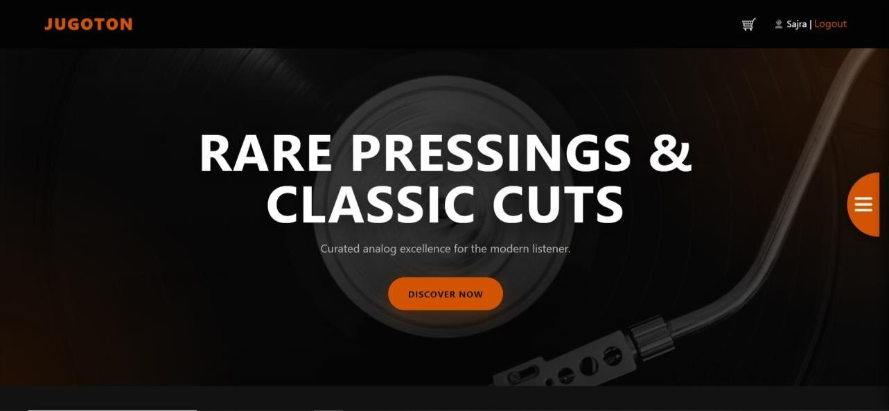
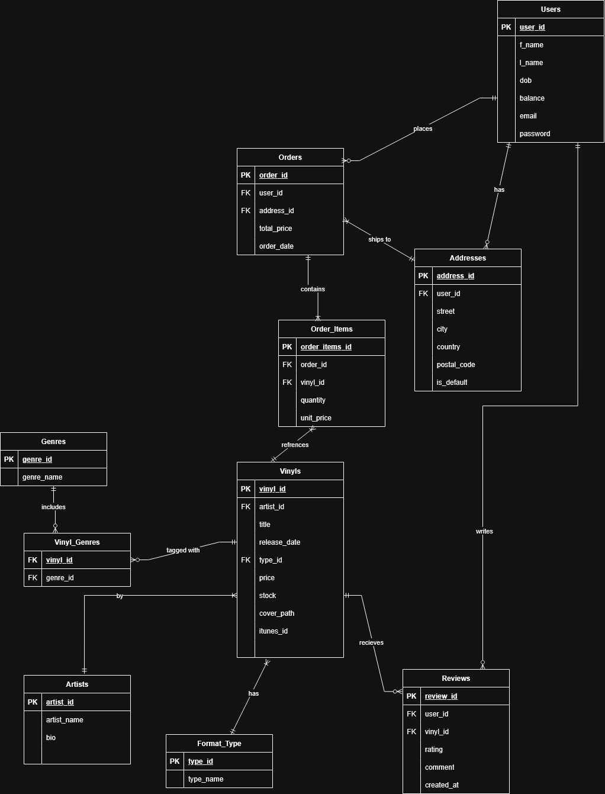

# Jugoton: a vinyl record shop (PHP and MySQL)

A working online record shop named after, and styled like, the old Yugoslav record label: dark, with orange accents. Customers browse, search, preview tracks, review records and check out. Admins manage records and artists and read sales reports.

Built in spring 2026 for three university courses at SSST (Web Environments, Database Systems and Cloud Computing), as a team of two. I built the full-stack app with my teammate Sajra Agić, and did the cloud deployment on my own.

**Demo video:** [docs/demo.mp4](docs/demo.mp4). An admin adds a record, the iTunes Search API fills in the details, and the record appears in the shop with its cover and preview player.

## Features

- Responsive front end in plain HTML, CSS and JavaScript, with a record-shaped menu button.
- Catalogue with new arrivals, search by title or artist, genre filtering with paging, and record pages with a 30-second iTunes track preview.
- Registration and login with hashed passwords (`password_hash`) and sessions, a profile with account balance, and separate customer and admin areas.
- Side cart and checkout that lowers the balance and the stock in one transaction.
- Reviews: one per user and record.
- Admin panel with full CRUD for records and artists, inventory, and reports (best sellers, most valuable customers, latest orders).
- New records are filled in automatically from the iTunes Search API (release date and iTunes ID). Choosing the artist triggers the lookup.

## The database

MySQL, designed from written business rules: an ER model first, normalised, then the application.

- 10 tables, 30+ business rules and 4 indexes
- 2 triggers (for example, one aborts an order item when there is not enough stock)
- A sales analytics view, an order procedure and a customer tier function

## Run it locally

You need PHP 8, MySQL or MariaDB, and a local web server such as XAMPP.

1. Create a database called `vinyl_shop` and import `db/vinyl_shop.sql`.
2. Check the connection settings in `db.php` (they default to the local MySQL `root` user with no password).
3. Put the project in your web server's folder and open `index.php`.

Demo accounts (created by the SQL file; the password for both is `demo1234`):

| Role | Email |
|---|---|
| Admin | admin@example.com |
| Customer | customer@example.com |

### Optional: cover image uploads

Uploaded covers can be stored in Oracle Cloud Object Storage. The app reads two environment variables, and nothing is committed to the repository:

- `OCI_PAR_URL`: a pre-authenticated request URL for the bucket
- `OCI_PUBLIC_BASE_URL`: the public base URL of the bucket

Without them, records use the default cover image.

## Tech

PHP, HTML, CSS, JavaScript, MySQL/MariaDB, the iTunes Search API. Deployed for the Cloud Computing course on an Oracle Cloud virtual machine (Ubuntu 24, Nginx, PHP 8.4-FPM). The server has since been shut down, so the demo video shows the full flow.

## Notes

This is a course project. Sample data is made up. The database file ships with demo accounts only.
